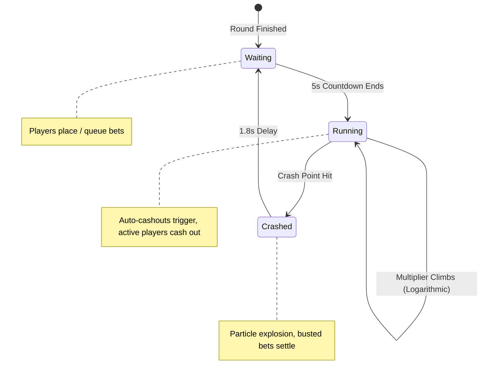

# 🚀 Lucky Fury (Lucky Jet)

<div align="center">


**A high-performance, real-time multiplayer Crash Gambling Game simulation built with React 18, TypeScript, HTML5 Canvas 2D, and Tailwind CSS.**

[](https://react.dev/)
[](https://www.typescriptlang.org/)
[](https://vitejs.dev/)
[](https://tailwindcss.com/)
[](https://developer.mozilla.org/en-US/docs/Web/API/Web_Audio_API)
[](https://vitest.dev/)

[Features](#-key-features) • [Game Mechanics](#-game-mechanics) • [Tech Stack](#-tech-stack) • [Project Structure](#-project-structure) • [Getting Started](#-getting-started) • [Contributing](#-contributing)

</div>

---

## 🎮 Overview

**Lucky Fury** is an interactive, responsive web simulation of modern iGaming crash games (such as *Lucky Jet*, *Aviator*, and *Bustabit*). Players place bets in Kenyan Shillings (KES), observe the multiplier ascend in real time, and try to cash out before the jet crashes!

The project features a **custom 60 FPS HTML5 Canvas engine**, **procedural vector jet rendering**, **zero-dependency procedural sound synthesis**, **live simulated multiplayer activity**, and **dual betting consoles**.

---

## ✨ Key Features

### ✈️ 60 FPS Canvas Game Engine
- **Hardware-Accelerated Flight**: Ultra-smooth 60 FPS animation loop driven by `requestAnimationFrame`.
- **Procedural Vector Drawing**: Jet fighter and cockpit canopy drawn mathematically via Bézier curves without heavy external sprite dependencies.
- **Logarithmic Multiplier Scale**: Prevents compression of steep multipliers ($1.00\times$ up to $100.00\times$) with logarithmic Y-axis distribution.
- **Dynamic Flight Trajectory**: Accelerating trajectory curve ($launchGrowth = 0.24t + 0.76t^{2.15}$) eliminating flat or dipping takeoffs.
- **Visual FX**: Dynamic animated exhaust trail, glowing neon trajectory path, and particle shockwave burst on crash.

### 👥 Live Simulated Community Bets
- **Multiplayer Activity**: Real-time simulation of 18 concurrent players placing bets, locking targets, and making auto-cashouts.
- **Synchronized Event Bus**: Canvas engine broadcasts custom DOM events (`luckyjet-round-state`) to keep live player statuses, multipliers, and round states in lockstep.
- **Categorized Tabs**:
  - `All Bets`: Active bets and real-time multipliers.
  - `My Bets / Previous Hand`: Archive of the most recent completed round.
  - `Top`: High-roller leaderboard sorted by largest payout.

### 🎛️ Dual-Console Betting System
- **Concurrent Panels**: Two independent betting panels (`Panel 1` and `Panel 2`) allowing players to execute dual betting and hedging strategies.
- **Modes & Stakes**: Instant toggle between manual `BET` and automated `AUTO BET` with quick-stake selectors (KES 100, 500, 1,000, 3,000) and step controls.

### 🔊 Procedural Web Audio Engine
- **Zero Asset Overhead**: Sounds are generated dynamically using native browser oscillators (`AudioContext`).
- **Sound Cues**:
  - `round-start`: Dual-tone frequency ascent (Square & Triangle).
  - `crash`: Low-frequency rumble with exponential decay (Sawtooth).
  - `toggle`: High-frequency UI feedback chime.
- **Persistence**: Sound mute/unmute state automatically stored in `localStorage`.

### 💰 Live Ticker & Jackpot Feed
- **Jackpot Ticker**: Real-time KES progressive jackpot counter with random increments.
- **Historic Marquee**: Continuous marquee banner displaying recent crash multipliers color-coded by rarity:
  - 🔵 **Blue** ($< 2.00\times$)
  - 🌸 **Pink** ($1.80\times - 2.00\times$)
  - 🟣 **Purple** ($2.00\times - 4.00\times$)
  - 🟡 **Yellow** ($4.00\times - 10.00\times$)
  - 🟢 **Green** ($> 10.00\times$ Jackpot Tier)

### 🎨 Sleek Dark Cyberpunk Design
- Fully responsive layout supporting mobile screens, tablets, and wide monitors.
- Designed with **Radix UI** primitives, **Tailwind CSS**, and modern HSL design tokens.
- Typography powered by **Inter** for user interface and **JetBrains Mono** for numeric readouts.

---

## 🕹️ Game Mechanics



1. **Waiting State**: A 5-second countdown prepares the next flight. Players arm or queue bets.
2. **Running State**: The jet launches from $1.00\times$. Multiplier accelerates upwards. Simulated players cash out at predetermined intervals.
3. **Crashed State**: The jet bursts into an explosion effect. Multiplier locks, all uncached bets bust, and previous hand stats update.

---

## 🛠️ Tech Stack

| Category | Technology |
| :--- | :--- |
| **Frontend Framework** | [React 18](https://react.dev/) + [TypeScript](https://www.typescriptlang.org/) |
| **Build Tool & Bundler** | [Vite 5](https://vitejs.dev/) with `@vitejs/plugin-react-swc` |
| **Styling** | [Tailwind CSS 3](https://tailwindcss.com/) + [tailwindcss-animate](https://github.com/jamiebuilds/tailwindcss-animate) |
| **UI Primitives** | [Radix UI](https://www.radix-ui.com/) + [shadcn/ui](https://ui.shadcn.com/) |
| **Icons** | [Lucide React](https://lucide.dev/) |
| **Audio** | Native HTML5 [Web Audio API](https://developer.mozilla.org/en-US/docs/Web/API/Web_Audio_API) (`OscillatorNode`, `GainNode`) |
| **State & Notifications** | React Hooks, Custom DOM Events, [Sonner](https://sonner.emilkowal.ski/) |
| **Testing** | [Vitest](https://vitest.dev/), [Playwright](https://playwright.dev/), [Testing Library](https://testing-library.com/) |

---

## 📂 Project Structure

```text
lucky--fury/
├── public/                 # Static assets, icons, and favicon
├── src/
│   ├── components/         # Game & UI components
│   │   ├── ui/             # Radix UI / shadcn component library (49+ primitives)
│   │   ├── BetPanel.tsx    # Betting console with stake controls & auto-bet
│   │   ├── BetsSidebar.tsx # Real-time multiplayer feed, cashouts & leaderboard
│   │   ├── CrashGraph.tsx  # 2D Canvas engine, flight physics & burst animation
│   │   ├── FooterNote.tsx  # Developer attribution banner
│   │   ├── JackpotTicker.tsx # Jackpot header & rolling multiplier marquee
│   │   ├── Navbar.tsx      # Top bar, demo balance, settings & auth modal
│   │   └── NavLink.tsx     # Navigation link helper
│   ├── hooks/              # Custom React hooks (mobile detection, toast)
│   ├── lib/                # Utility modules
│   │   ├── sound.ts        # Web Audio procedural sound synthesizer
│   │   └── utils.ts        # Tailwind merge & clsx class utility
│   ├── pages/              # Route entry points
│   │   ├── Index.tsx       # Main dashboard layout
│   │   └── NotFound.tsx    # 404 Error page
│   ├── test/               # Vitest unit test suites
│   ├── App.tsx             # Root application & provider tree
│   ├── index.css           # Design tokens, keyframes & theme layers
│   └── main.tsx            # DOM bootstrap
├── index.html              # HTML shell & crypto polyfill
├── package.json            # Scripts & dependencies
├── playwright.config.ts    # E2E test configuration
├── tailwind.config.ts      # Custom Tailwind theme extension
└── vite.config.ts          # Vite build & alias settings
```

---

## 🚀 Getting Started

### Prerequisites

- **Node.js** (v18.0.0 or higher recommended)
- **npm**, **yarn**, or **bun**

### Installation

1. **Clone the repository:**
   ```bash
   git clone git@github.com:Rotz-kirwa/lucky--fury.git
   cd lucky--fury
   ```

2. **Install dependencies:**
   ```bash
   npm install
   # or
   bun install
   ```

3. **Start the development server:**
   ```bash
   npm run dev
   # or
   bun dev
   ```

4. **Open in browser:**
   Navigate to [http://localhost:8080](http://localhost:8080) to play!

---

## 🧪 Testing & Verification

- **Run Unit Tests:**
  ```bash
  npm run test
  ```

- **Run Vitest in Watch Mode:**
  ```bash
  npm run test:watch
  ```

- **Run Linter:**
  ```bash
  npm run lint
  ```

- **Production Build:**
  ```bash
  npm run build
  ```

---

## 🔒 Provably Fair Concept

In standard commercial crash gambling applications, round multipliers are verified cryptographically via a **Client Seed**, **Server Seed**, and **Nonce** using HMAC-SHA256:

$$\text{Hash} = \text{HMAC-SHA256}(\text{ServerSeed}, \text{ClientSeed} : \text{Nonce})$$

Lucky Fury features an interactive **Provably Fair** dialog in the sidebar footer, demonstrating round transparency concepts and preparation for live backend seed verification integration.

---

## 📄 License

This project is open-source and available under the [MIT License](LICENSE).

---

<div align="center">
  <sub>Built with ❤️ by <b>NOVATECH</b> & <b>Rotz-kirwa</b></sub>
</div>
